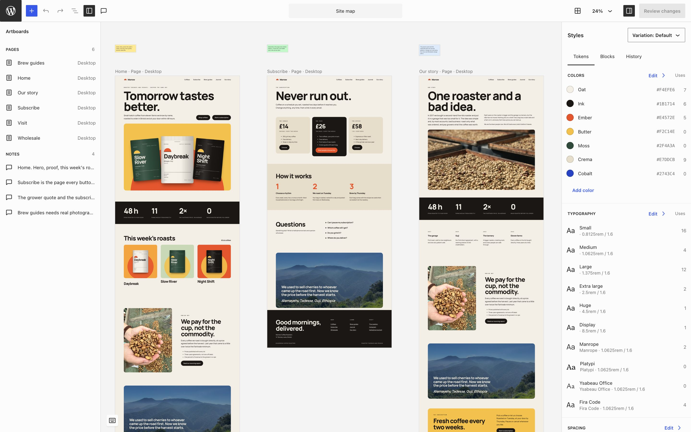
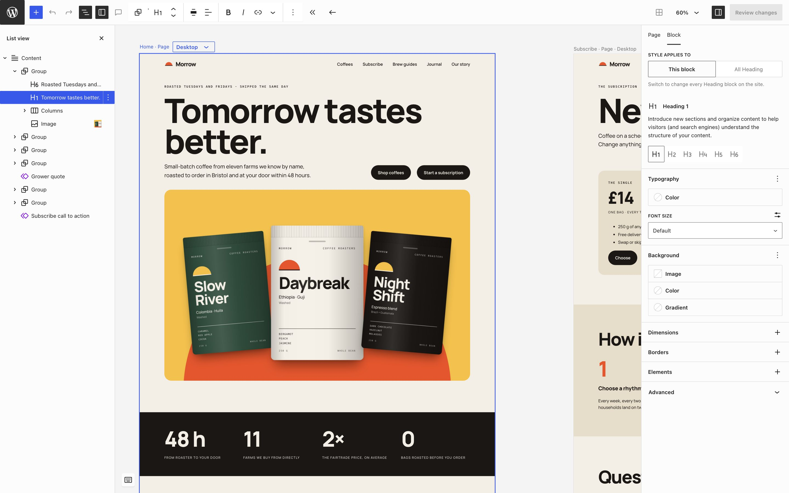
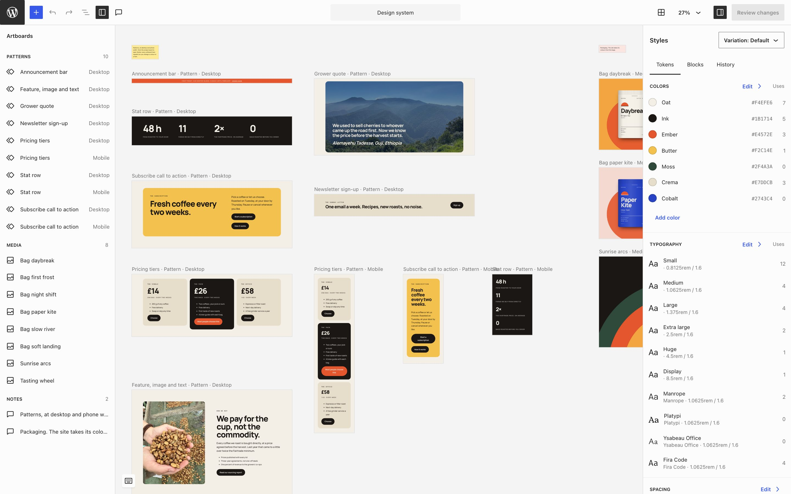
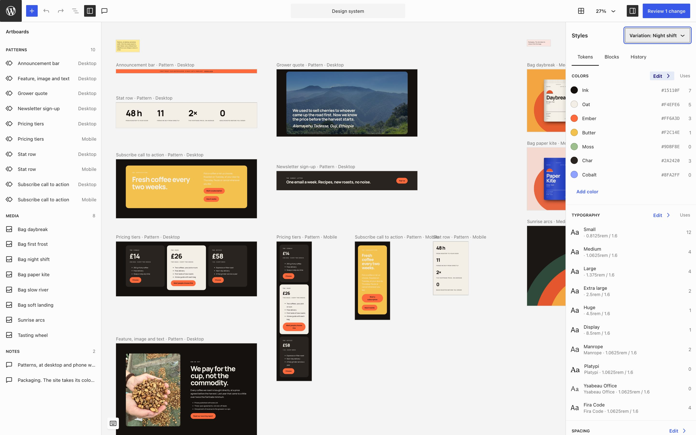
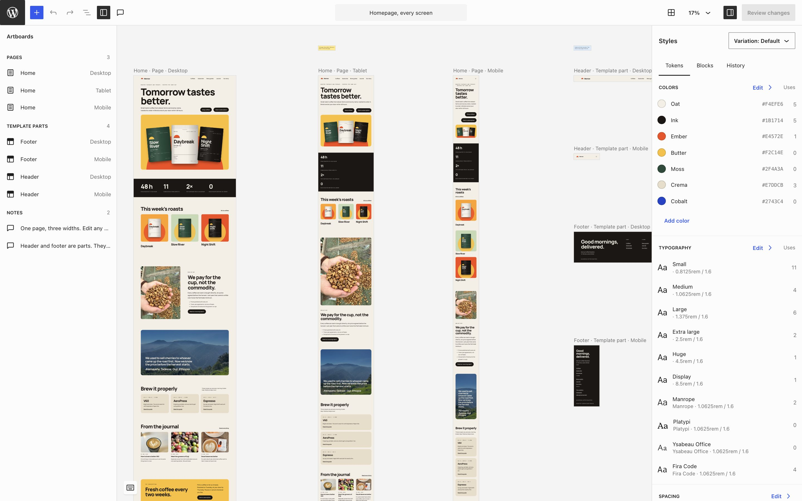
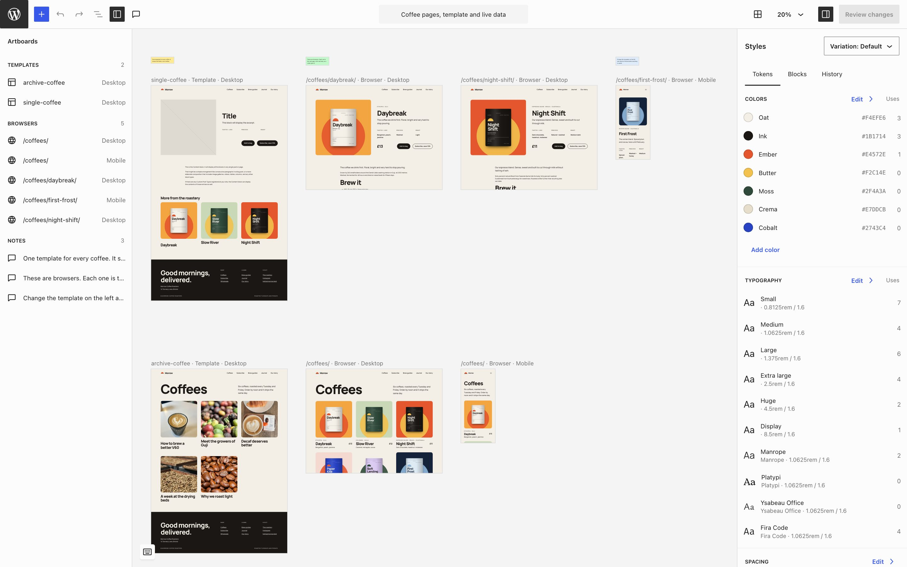
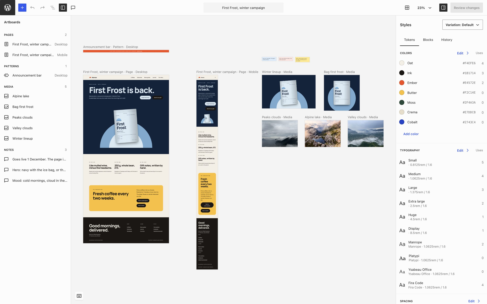

# WordPress for Designers

[](https://playground.wordpress.net/?blueprint-url=https://raw.githubusercontent.com/draganescu/wordpress-for-designers/master/blueprint.json)

A WordPress plugin that opens an infinite canvas (a board) inside WordPress. Each artboard on the board shows one page, template, template part or pattern of the site, rendered with real blocks. One artboard at a time can be edited with a block editor, and global styles are edited from the same screen and repaint every artboard.



## What it does

### Your whole site on one canvas

Every artboard is a real page, template, template part or pattern, rendered with the site's own blocks and styles. Pan and zoom from a whole site down to one heading.

### Edit in place

Double-click an artboard to edit it with the block editor. The block toolbar, the list view and the inspector sit around the canvas; the rest of the board stays where it was.



### Styles that repaint everything

With nothing selected, the right panel edits the site's styles: colours, typography, spacing, each with a count of where it is used. Change one, or switch to another style variation, and every artboard follows.

| The theme's own styles | The "Night shift" variation |
|---|---|
|  |  |

### One page at every width

The same page, header or footer can sit on the board at desktop, tablet and phone width. Edit any of them: it is the same content.



### Templates beside real data

A template shows fields, not content. A browser artboard shows the real page a visitor gets, so a template can be designed next to the pages that use it, and changes show there before anything is saved.



### A board for each piece of work

A site can have many boards. Images from the media library and notes sit on the canvas next to the artboards.



Nothing reaches the site until "Review changes" is used.

The screenshots show the demo site, Morrow Coffee Roasters. [demo/README.md](demo/README.md) says how to run it.

## Try it

The **Try it in WordPress Playground** button starts a WordPress site in your browser with the latest build of `master` installed, seeds it with the demo site, Morrow Coffee Roasters, and opens the Boards screen with seven boards to explore. Nothing is installed on your computer, and the site is discarded when you close the tab.

## Requirements

- WordPress 7.1 or later
- PHP 7.4 or later
- A block theme

## Develop

```bash
npm ci
npm run build
npm run wp-env start
```

The site runs at http://localhost:8888. End-to-end tests run with `npm run test:e2e`.

A seeded demo site with its own WordPress on port 8900 is in [demo/](demo/README.md).

## Release

Pushing a version tag builds the plugin and each adapter under `adapters/`, and attaches their zips to a GitHub release:

```bash
npm version minor -m "Release %s"
```

```bash
git push --follow-tags
```

`npm version` sets the version in `package.json`, the plugin file and each adapter, commits and tags. Each release line has its own branch, and a tag on it releases that line. See "Releasing it" in [docs/state.md](docs/state.md).

## Documentation

- [docs/state.md](docs/state.md): what exists now and how to run it
- [docs/working-notes.md](docs/working-notes.md): how the work was done
- [spec/](spec/): the specification the plugin is built from
- [demo/README.md](demo/README.md): the demo site, its boards and how the screenshots are taken

## License

GPL-2.0-or-later
