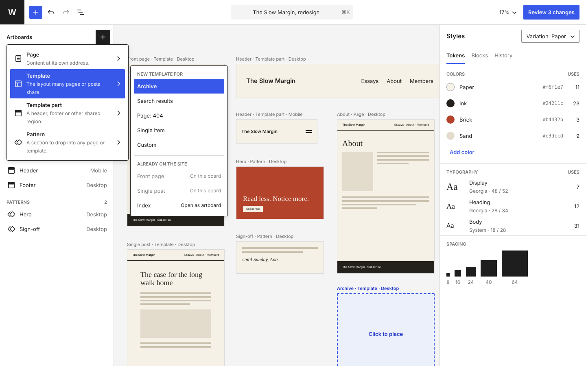

# New artboard 1: pick the kind from the menu, then place

**State.** The Add artboard menu is open at its second level and the pointer is over the board.

**Source.** [U] [D:AddArtboard]

## Regions used (defined in README.md)

- Header
- Left panel, artboards by kind (L2 pressed)
- Canvas
- Right panel, Styles

## Elements specific to this screen

| Element | Components and text | Behaviour |
|---|---|---|
| Kind menu | `Menu` from L2 with four items, each an icon, a title and one line: "Page" / "Content at its own address."; "Template" / "The layout many pages or posts share."; "Template part" / "A header, footer or other shared region."; "Pattern" / "A section to drop into any page or template."; "Browser" / "The site as visitors see it." (D55), `globe` icon. Template has a submenu. | Page, Template part, Pattern and Browser arm placement at once. A browser is placed showing "/", selected and not browsing; its ghost is labelled "/ · Browser · Desktop" and is 900 board units tall. |
| Template submenu | Group label "New template for" with items "Archive", "Search results", "Page: 404", "Single item", "Custom" (existing purposes omitted); separator; group label "Already on the site" listing each existing template: on this board, disabled with "On this board"; otherwise with "Open as artboard". | Choosing an item arms placement for that template. |
| Placement ghost | A dashed brand outline at the pointer, sized as the Desktop device at the current zoom, labelled "{Name} · {Kind} · Desktop" and "Click to place". | Click places the artboard there with device Desktop and enters edit (at the current zoom, or fitted first when below 30%, D37). Esc cancels. |

## Acceptance criteria

AC-NEW-01, AC-NEW-02, AC-NEW-03, AC-NEW-04
