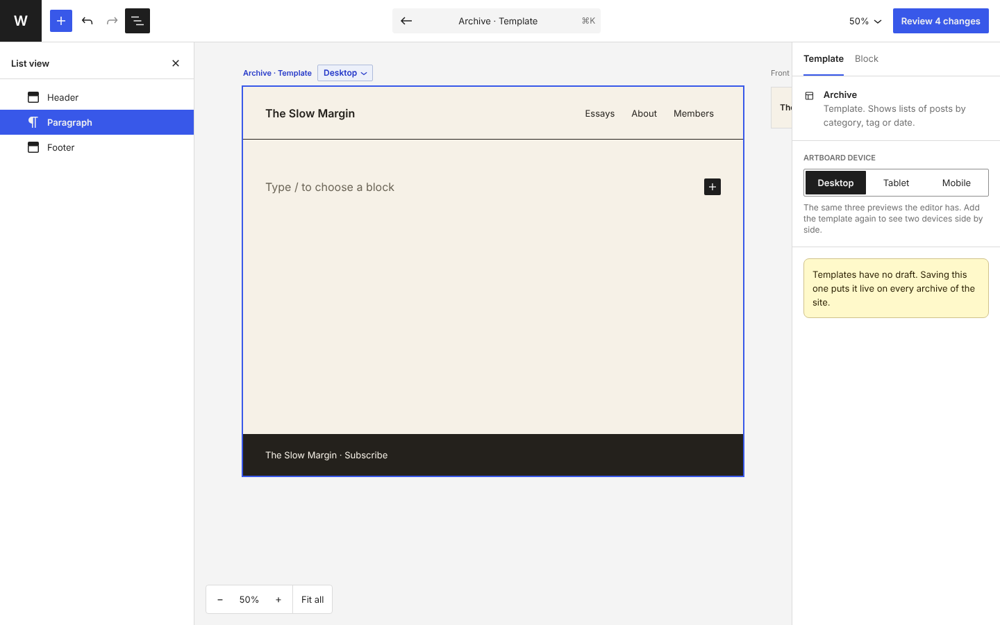

# New artboard 2: placed and in edit

**State.** A new Archive template has just been placed. It is in edit with the stock empty paragraph between the theme's Header and Footer.

**Source.** [U] [D:AddArtboard2]

## Regions used (defined in README.md)

- Header (document bar "Archive · Template"; Review counts the new template)
- Left panel, list view
- Canvas (A2)
- Right panel, editing (Template tab)

## Elements specific to this screen

| Element | Components and text | Behaviour |
|---|---|---|
| Template tab | E5 with name "Archive" and description "Template. Shows lists of posts by category, tag or date." (the description is the template type's own description from WordPress); E6; help under E6: "The same three previews the editor has. Add the template again to see two devices side by side."; E7. |  |

## Acceptance criteria

AC-NEW-04, AC-NEW-05, AC-NEW-06, AC-EDIT-04
