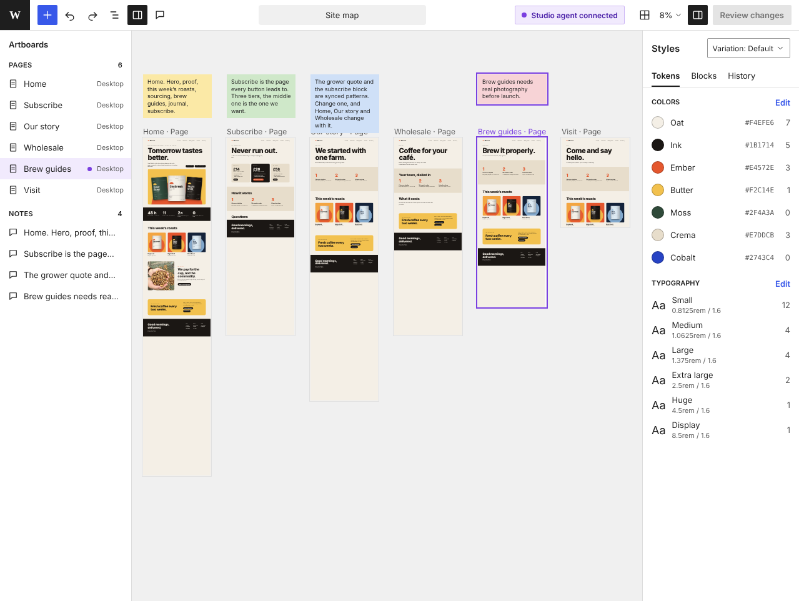

# Board: an agent is connected

**State.** A board with nothing selected, during an agent session. No call is running and nothing has been changed.

**Source.** [U] for showing that an agent is connected (D73); [A]; the chip's wording and place are [N]

The image is cut from the design of a session in WordPress Studio, so it shows the demo site (Morrow Coffee Roasters) and not the fixture. Three things in it are not built as drawn: the chip reads "Studio agent connected" and is violet, where G1 reads "Agent connected" and is a `Badge` in its default colours, because the plugin names no harness (C32) and colours come from the design system (C4); and the "Annotate" control and the address bar above the header belong to Studio.

## Regions used (defined in README.md)

- Header, with G1
- Left panel, artboards by kind
- Canvas
- Right panel, Styles

## Elements specific to this screen

| Element | Components and text | Behaviour |
|---|---|---|
| G1 | As in `agent/surface.md`, Marks: `Badge`, "Agent connected" | Not interactive. Present from the poll that finds a session until the poll that finds it ended. |

## Acceptance criteria

AC-AGENT-01, AC-MARK-01
