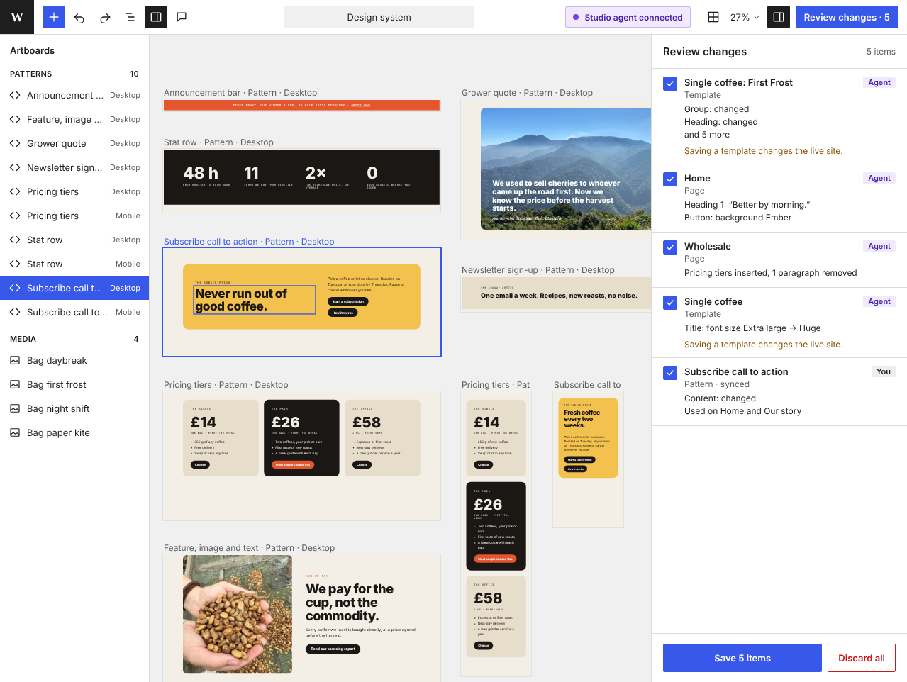

# Review changes: who changed what

The screen is `Review.md` with one addition, the badge G4. The image is cut from the design of a session in WordPress Studio and is a reference for the badge alone. Not built as drawn: the drawer's width and its place beside the board (the drawer is the one of `Review.md`), the "5 items" count, the footer's wording, the "You" badge (an item only the designer changed has none), the violet colour, the wording of the change lines, and the chip's "Studio agent connected".

**State.** The Review drawer during or after an agent session, with items changed by the agent and one changed by the designer.

**Source.** [U] for Review telling the agent's changes from the designer's (D73); [A]; the badge and its wording are [N]

## Regions used (defined in README.md)

- Header

## Elements specific to this screen

| Element | Components and text | Behaviour |
|---|---|---|
| G4 | `Badge` after the item name in the card's header, before "Discard": "Agent" on an item only the agent changed; "Agent and you" on an item both changed. An item only the designer changed has no badge | Not interactive. Everything else on the card, and saving and discarding, are as in `Review.md`. |

## Acceptance criteria

AC-MARK-04, AC-MARK-05, AC-TOOL-21, AC-TOOL-22
