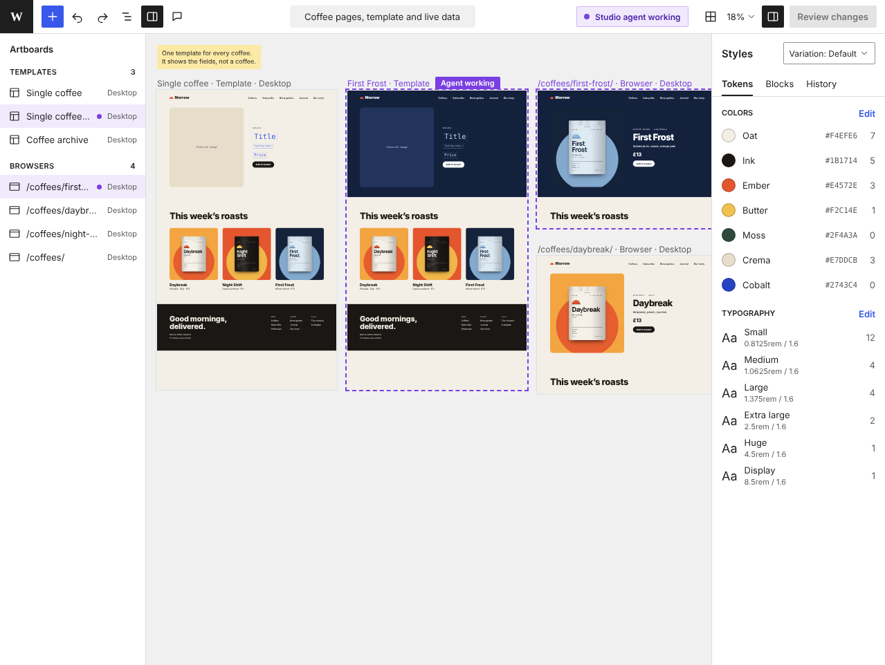

# Board: an agent is working

**State.** An agent session. A call is running on the second artboard, and an earlier call changed it.

**Source.** [U] for showing what the agent works on and what it changed (D73); [A]; the wording, the outline and the one-second stay are [N]

The image is cut from the design of a session in WordPress Studio, as `AgentConnected.md` says. Not built as drawn: the violet colour, the chip's "Studio agent working" (G1 reads "Agent working"), the tag drawn after the artboard's label, which is built as the label's ending "· Agent working", and the dots on rows of the left panel, which are not built at all.

## Regions used (defined in README.md)

- Header, with G1
- Left panel, artboards by kind
- Canvas (A1 with G2 on the working artboard)
- Right panel, Styles

## Elements specific to this screen

| Element | Components and text | Behaviour |
|---|---|---|
| G1 | `Badge`, "Agent working" | While a call runs and for one second after the last one ends; then "Agent connected". |
| G2 | The label of the artboard the call names ends in "· Agent working", and the artboard has a dashed brand outline (`agent/surface.md`, Marks) | From the start of the call until one second after it ends. It does not select the artboard and takes no pointer input. |
| G3 | After G2 goes, the label of every artboard showing an item the agent changed ends in "· Changed by agent" | Until the item is saved or discarded. While the Review drawer is open the drawer's own "· Changed" and outline show in its place. |

## Acceptance criteria

AC-MARK-01, AC-MARK-02, AC-MARK-03, AC-MARK-07
