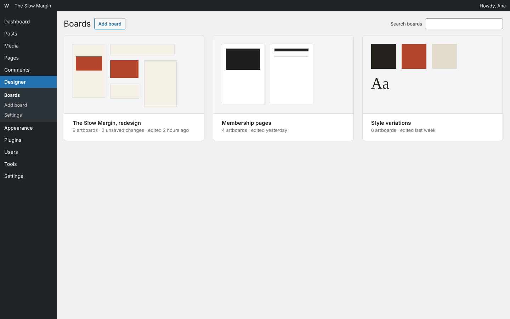

# Boards in wp-admin

**State.** The Designer › Boards page inside normal wp-admin.

**Source.** [U] [D:Boards]; "Untitled board", the card actions and the two omissions are [N]

## Elements specific to this screen

| Element | Components and text | Behaviour |
|---|---|---|
| wp-admin chrome | Stock admin bar and menu. Menu item "Designer" with sub-items "Boards" and "Add board". (The "Settings" sub-item in the image is not built.) |  |
| Page | `Page` from `@wordpress/admin-ui`, title "Boards", action `Button` "Add board"; `DataViews` in grid layout with search placeholder "Search boards". Each card: a neutral placeholder area, the board name, and "{n} artboards · edited {relative time}" ("1 artboard"). (The miniature layouts and "unsaved changes" text in the image are not built.) | A card opens the board app. Add board creates a board titled "Untitled board" and opens it. The card's actions menu has "Rename" (a `Dialog` with one text field, an `InputControl` labelled "Name", "Cancel", "Save") and "Move to trash". |

## Acceptance criteria

AC-BOARD-01, AC-BOARD-02, AC-BOARD-03, AC-BOARD-04
