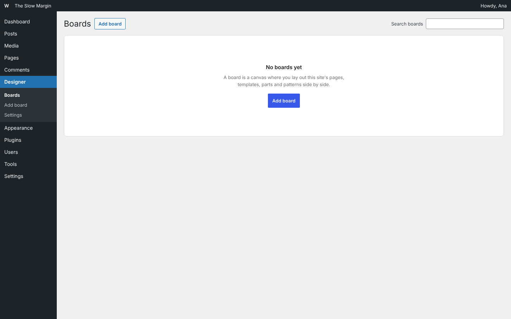

# Boards in wp-admin: no boards

**State.** No boards exist.

**Source.** [U]

## Elements specific to this screen

| Element | Components and text | Behaviour |
|---|---|---|
| Empty state | `EmptyState` in place of the grid: title "No boards yet", text "A board is a canvas where you lay out this site's pages, templates, parts and patterns side by side.", `Button` solid "Add board". |  |

## Acceptance criteria

AC-STATE-04
