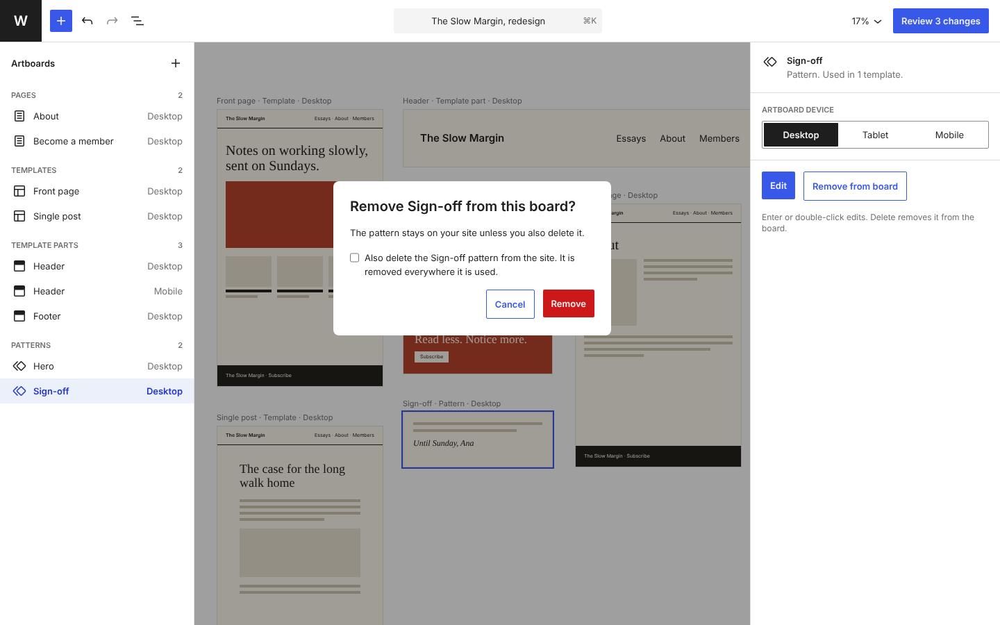

# Remove artboard: a pattern you made

**State.** Sign-off (a user pattern) is selected and Delete was pressed.

**Source.** [U]; wording for pages and user templates is [N]

## Regions used (defined in README.md)

- Header
- Left panel, artboards by kind
- Canvas
- Right panel (artboard settings)

## Elements specific to this screen

| Element | Components and text | Behaviour |
|---|---|---|
| Dialog | `AlertDialog`: title "Remove {name} from this board?"; body by entity: page "The page stays on your site unless you also delete it."; pattern "The pattern stays on your site unless you also delete it."; user template or part "The {kind} stays on your site unless you also delete it."; `wpc.CheckboxControl`, unchecked: page "Also move the {name} page to the trash."; pattern "Also delete the {name} pattern from the site. It is removed everywhere it is used."; user template or part "Also delete the {name} {kind} from the site."; buttons "Cancel" (outline) and "Remove" (solid, error tone when the box is checked, brand otherwise). | See `data-model.md`, Removing. |

## Acceptance criteria

AC-DEL-01, AC-DEL-02
