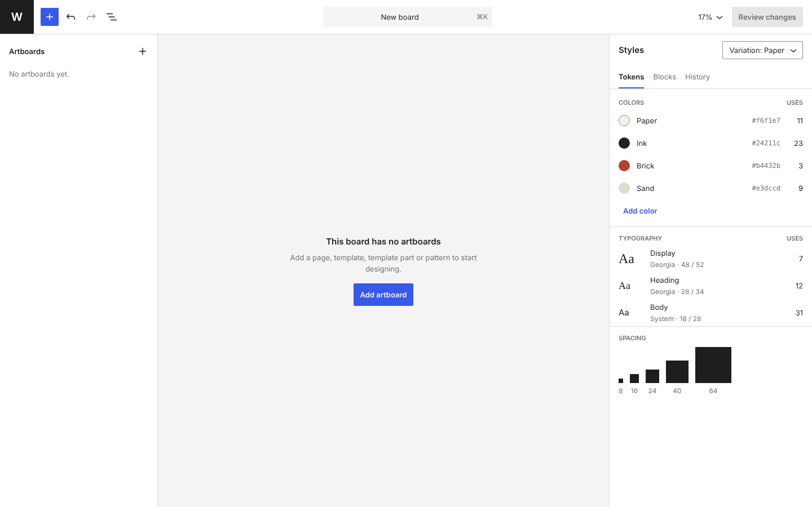

# Board: empty

**State.** A board with no artboards.

**Source.** [U]

## Regions used (defined in README.md)

- Header (H9 disabled)
- Canvas
- Right panel, Styles

## Elements specific to this screen

| Element | Components and text | Behaviour |
|---|---|---|
| Left panel | L1 and L2, then `Text` weak "No artboards yet." |  |
| Empty state | `EmptyState` centred in the canvas: title "This board has no artboards", text "Add a page, template, template part or pattern to start designing.", `Button` solid "Add artboard". | The button opens the same menu as L2. |

## Acceptance criteria

AC-STATE-01
