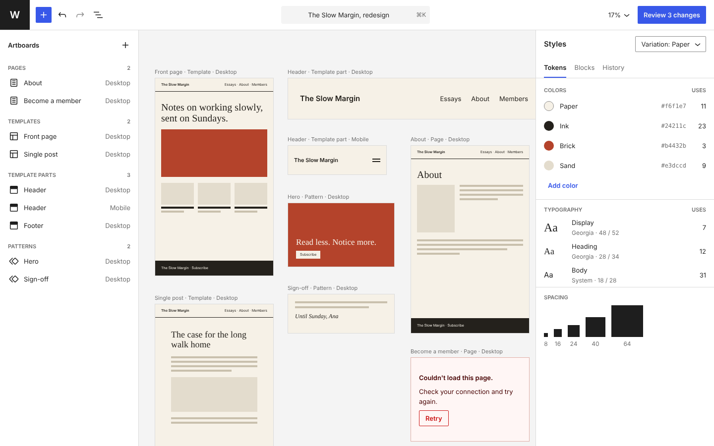

# Board: an artboard failed to load

**State.** One artboard's entity could not be loaded.

**Source.** [U]

## Regions used (defined in README.md)

- Header
- Left panel, artboards by kind
- Canvas
- Right panel, Styles

## Elements specific to this screen

| Element | Components and text | Behaviour |
|---|---|---|
| Error artboard | In place of the artboard content, at the cached size (minimum 170 px high): `Notice` error tone, title "Couldn't load this {kind}." ("page", "template", "template part", "pattern"), text "Check your connection and try again.", `Button` outline error "Retry". The A1 label is unchanged. | Retry requests the entity again. |

## Acceptance criteria

AC-STATE-05
