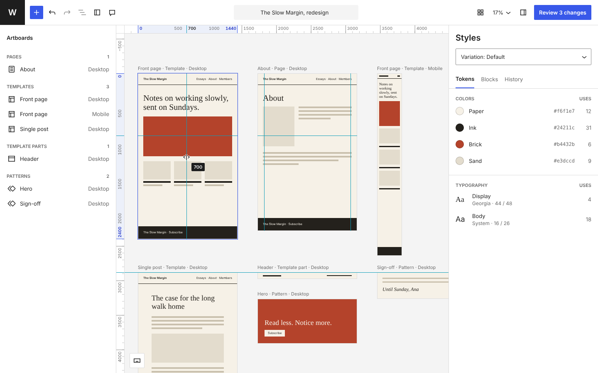

# Board: dragging a guide out of a ruler

**State.** The pointer was pressed on the left ruler and dragged over Front page; the button is still down. Nothing is selected.

**Source.** [U] [D:GuideDrag] [R1] [R4]

## Regions used (defined in README.md)

- Header
- Left panel, artboards by kind
- Canvas, with Rulers (R1 to R5) and Guides (GD1, GD2)
- Right panel, Styles (Tokens tab)

## Elements specific to this screen

| Element | Components and text | Behaviour |
|---|---|---|
| Guide being dragged | GD1 across Front page only, from its top edge to its bottom edge, under the pointer. GD2 beside the pointer reads "700". | Follows the pointer by changing the DOM (C35). Released here it becomes a vertical guide of Front page on Desktop at 700, selected (D110, D111). |
| Artboard under the pointer | A 1 px brand stroke around Front page. | Shows which artboard the guide will belong to. Absent over empty board, where the line runs from edge to edge of the canvas area. |
| Rulers | Zero is Front page's top-left corner and R4 shades its extent ("0", "1440"; "0", "2400"). R5 on the top ruler marks the dragged guide with "700". | Follow the artboard under the pointer while the drag lasts. |
| Pointer | `col-resize` for a vertical guide, `row-resize` for a horizontal one. | |

Nothing snaps (D110): the position is where the pointer is, as a whole number.

## Acceptance criteria

AC-GUIDE-01, AC-GUIDE-02, AC-GUIDE-03
