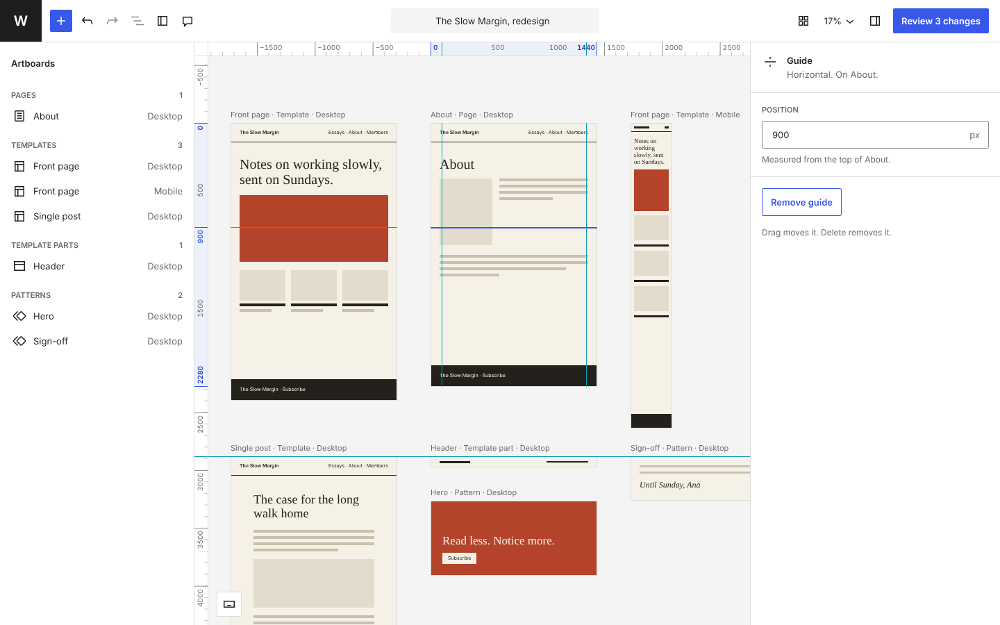

# Board: a guide selected

**State.** About's horizontal guide at 900 is selected by a click on its line. No artboard is selected.

**Source.** [U] [D:GuideSelected] [R1] [R3]

## Regions used (defined in README.md)

- Header
- Left panel, artboards by kind (no row highlighted)
- Canvas, with Rulers (R1 to R5) and Guides (GD1, GD3)
- Right panel: Guide card (GD4)

## Elements specific to this screen

| Element | Components and text | Behaviour |
|---|---|---|
| Selected guide | GD3 on About at 900. | Dragged, it moves up and down within About. |
| Rulers | Zero is About's top-left corner; R4 shades About's extent. R5 on the left ruler marks the selected guide in the brand colour with "900"; About's other guides and the board guide are marked without a number. | |
| Right panel: Guide card | GD4 with the description "Horizontal. On About.", "900" in the Position field and the help "Measured from the top of About." | See GD4. |

## Acceptance criteria

AC-GUIDE-06, AC-GUIDE-07, AC-GUIDE-08
