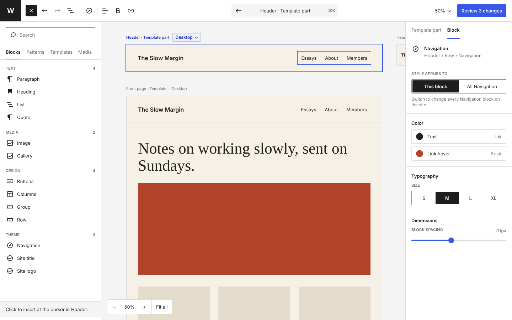

# Inserter: Blocks, while editing

**State.** Inserter on, Blocks tab, Header in edit.

**Source.** [U]; the no-artboard hint is [N]

## Regions used (defined in README.md)

- Header (H2 on, H6 present)
- Left panel, inserter
- Canvas
- Right panel, editing

## Elements specific to this screen

| Element | Components and text | Behaviour |
|---|---|---|
| Blocks tab | One group per block category with its count; rows: `be.BlockIcon`, block title. Only blocks the Live editor allows at the insertion point are listed. Hint: "Click to insert at the cursor in {artboard name}."; with no artboard in edit: "Edit an artboard to insert blocks." |  |

## Acceptance criteria

AC-INS-01, AC-INS-03
