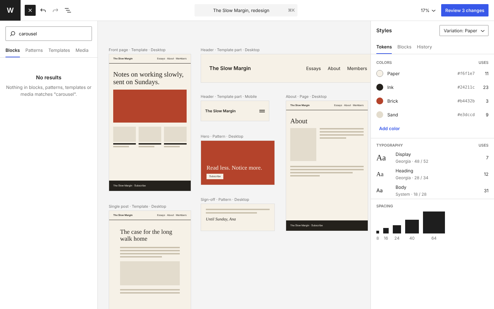

# Inserter: no results

**State.** A search that matches nothing.

**Source.** [U]

## Regions used (defined in README.md)

- Header (H2 on)
- Left panel, inserter
- Canvas
- Right panel, Styles

## Elements specific to this screen

| Element | Components and text | Behaviour |
|---|---|---|
| Empty state | `EmptyState` in place of the list: title "No results", text "Nothing in blocks, patterns, templates or media matches \"{query}\"." | Shown when the query matches nothing in any tab. |

## Acceptance criteria

AC-STATE-02
