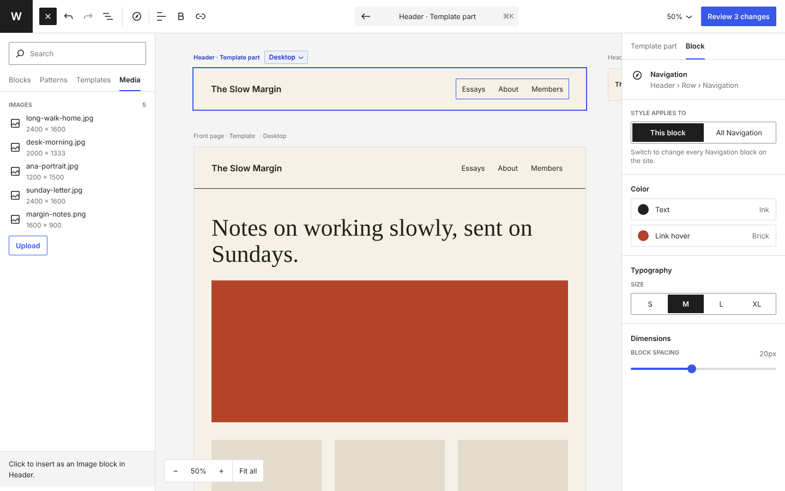

# Inserter: Media, while editing

**State.** Inserter on, Media tab, Header in edit.

**Source.** [U]; the limit of 50 is [N]

## Regions used (defined in README.md)

- Header (H2 on, H6 present)
- Left panel, inserter
- Canvas
- Right panel, editing

## Elements specific to this screen

| Element | Components and text | Behaviour |
|---|---|---|
| Media tab | Group "Images" with count; rows: `image` icon, file name, second line "{width} × {height}". The 50 most recent images, filtered by search. `be.MediaUpload` behind a `Button` outline "Upload". Hint: "Click to insert as an Image block in {artboard name}." | Click inserts an Image block for that attachment at the insertion point. |

## Acceptance criteria

AC-INS-08
