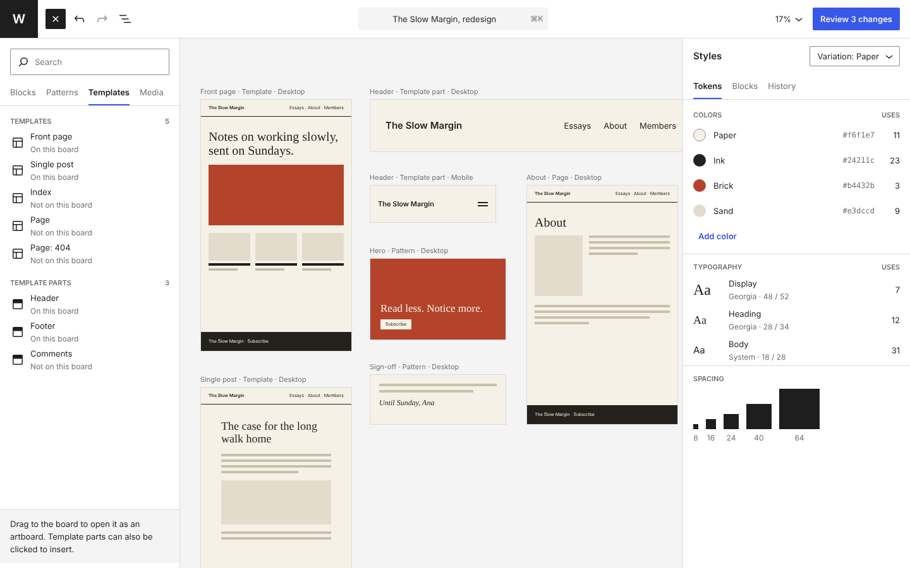

# Inserter: Templates

**State.** Inserter on, Templates tab, nothing in edit.

**Source.** [U]

## Regions used (defined in README.md)

- Header (H2 on)
- Left panel, inserter
- Canvas
- Right panel, Styles

## Elements specific to this screen

| Element | Components and text | Behaviour |
|---|---|---|
| Templates tab | Groups "Templates" and "Template parts"; rows: `layout` or `header` icon, name, second line "On this board" or "Not on this board". Hint with no artboard in edit: "Click or drag to the board to open it as an artboard."; in edit: "Click or drag a template part to insert it into {artboard name}." | Click and drag do the same thing (D39). With no artboard in edit, a click or a drag to empty board opens the template or part as an artboard (Desktop). In edit, a click inserts a Template Part block for a part at the insertion point and a drag inserts it where it is dropped in the artboard; a template row does nothing. |

## Acceptance criteria

AC-INS-04, AC-INS-07
