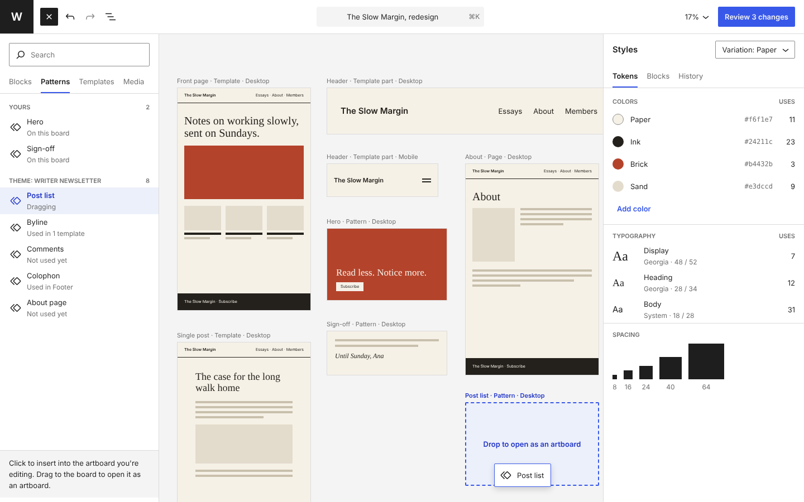

# Board: inserter open, dragging a pattern

**State.** Inserter on, Patterns tab, the Post list pattern is being dragged over empty board.

**Source.** [U] [D:Library]; the copy rule for theme patterns is [N]

## Regions used (defined in README.md)

- Header (H2 on)
- Left panel, inserter
- Canvas
- Right panel, Styles

## Elements specific to this screen

| Element | Components and text | Behaviour |
|---|---|---|
| Patterns tab | Groups: "Yours" (user patterns), then one group per source, "Theme: {theme name}". Each row: `symbol` icon, name, second line: "On this board", "Used in {n} templates" / "Used in 1 template", "Used in {part or template name}" when exactly one, or "Not used yet". Hint: "Click to insert into the artboard you're editing. Drag to the board to open it as an artboard." | Drag shows a chip with the icon and name. |
| Drop target | While dragging over empty board: a dashed brand outline labelled "{Name} · Pattern · Desktop" and "Drop to open as an artboard". | Drop adds the artboard (Desktop) at that position, selected, not in edit. A theme pattern is first copied to a new user pattern with the same title, status draft, and the artboard references the copy. |

## Acceptance criteria

AC-INS-02, AC-INS-04, AC-INS-05, AC-INS-06
