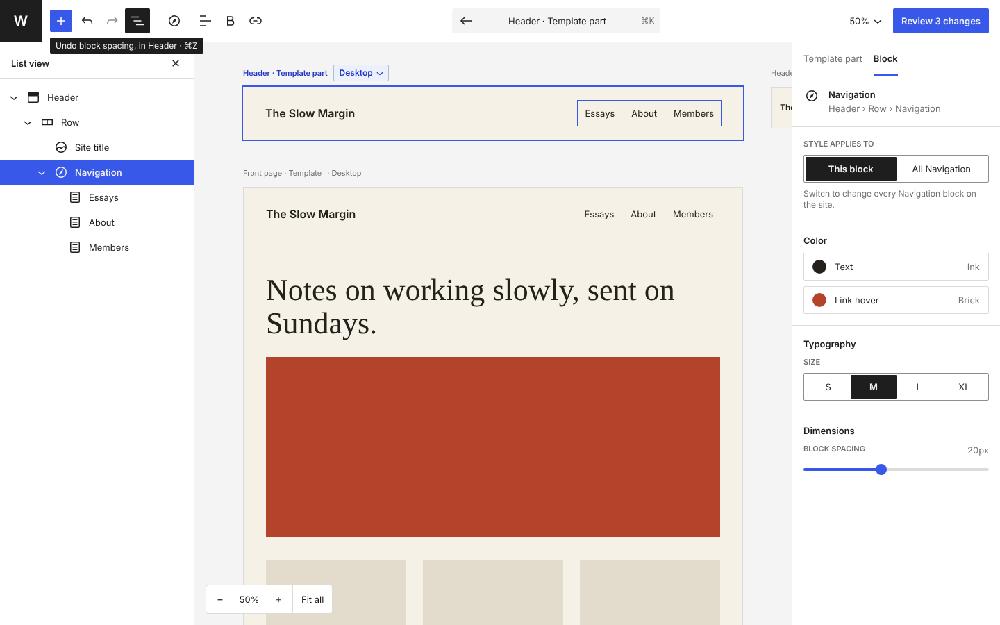

# Board: editing an artboard

**State.** Header (template part, Desktop) is in edit at 50%, as drawn (C18, D37). Its Navigation block is selected. Front page, below it, is a Preview showing the same header.

**Source.** [U]

## Regions used (defined in README.md)

- Header (H6 block toolbar present, with H14 at its end; of the document bar only the back arrow, next to it. The image was drawn before D50 and still shows the title "Header · Template part" beside the toolbar; the title shows when the toolbar is hidden with H14. Undo tooltip shown as an example)
- Left panel, list view
- Canvas (A2 on the Live artboard)
- Right panel, editing (Block tab)

## Acceptance criteria

AC-EDIT-01, AC-EDIT-02, AC-EDIT-03, AC-UNDO-01, AC-STYLE-06
