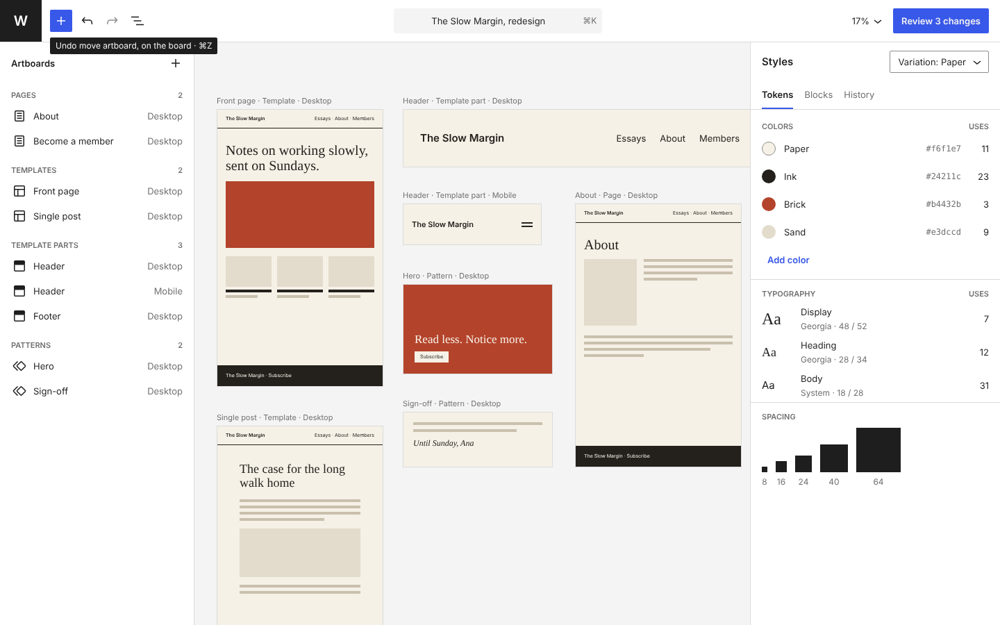

# Board: no artboard selected

**State.** Board at rest, nothing selected, zoom fitted to all artboards.

**Source.** [U] [B2]

## Regions used (defined in README.md)

- Header (document bar shows the board name)
- Left panel, artboards by kind
- Canvas
- Right panel, Styles (Tokens tab)

## Acceptance criteria

AC-SHELL-01, AC-STYLE-01, AC-CANVAS-01
