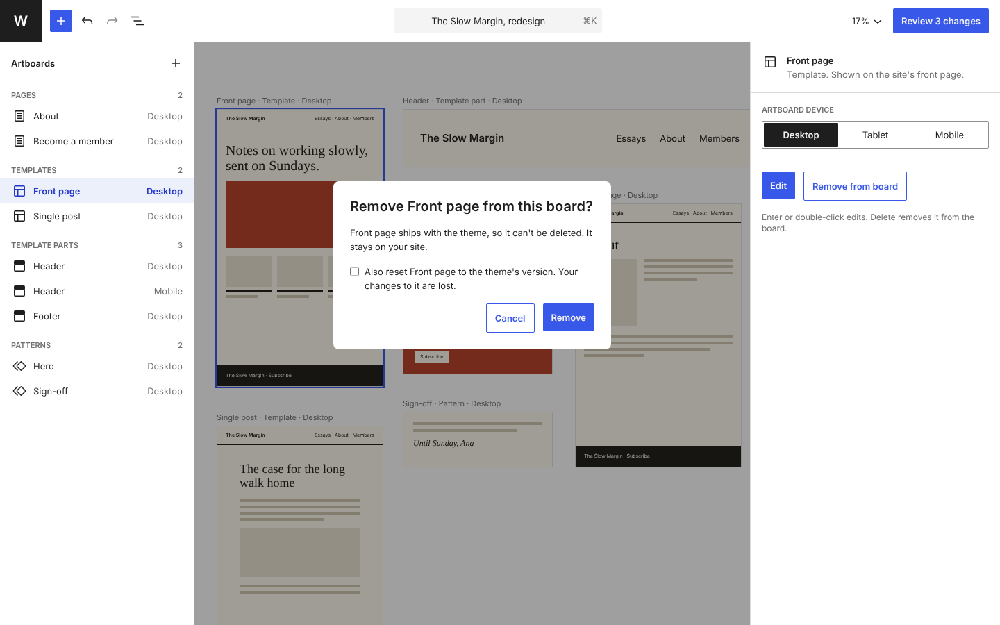

# Remove artboard: a theme template

**State.** Front page (ships with the theme) is selected and Delete was pressed.

**Source.** [U]; hiding the checkbox is [N]

## Regions used (defined in README.md)

- Header
- Left panel, artboards by kind
- Canvas
- Right panel (artboard settings)

## Elements specific to this screen

| Element | Components and text | Behaviour |
|---|---|---|
| Dialog | `AlertDialog`: title "Remove {name} from this board?"; body "{name} ships with the theme, so it can't be deleted. It stays on your site."; `wpc.CheckboxControl`, unchecked: "Also reset {name} to the theme's version. Your changes to it are lost."; buttons "Cancel" and "Remove". The checkbox is absent when the item has no user changes. | See `data-model.md`, Removing. |

## Acceptance criteria

AC-DEL-03
