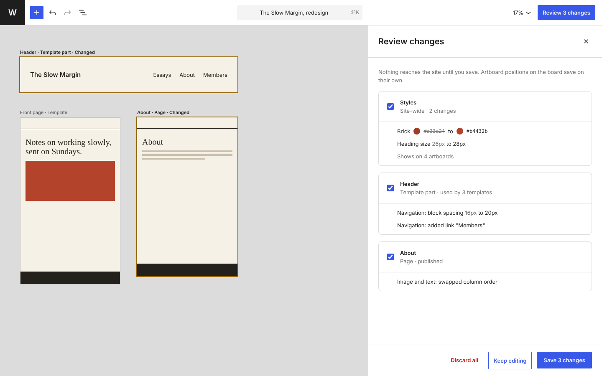

# Review changes

**State.** The Review drawer with three changed items.

**Source.** [U] [D:Review]; the "Discard" control of each item is D48 and is not in the image; the discard confirmation, the five-line limit and the wording of block change lines are [N]

## Regions used (defined in README.md)

- Header

## Elements specific to this screen

| Element | Components and text | Behaviour |
|---|---|---|
| Drawer | `Drawer` large (560) from the right, over a dimmed board. Title "Review changes", close `IconButton`. Intro: "Nothing reaches the site until you save. Artboard positions on the board save on their own." One `Card` per changed item with a checked `wpc.CheckboxControl`, the item name, a second line, a `Button` minimal "Discard" at the end of the card's header (D48), and its changes. Second line: styles "Site-wide · {n} changes"; template part "Template part · used by {n} templates"; template "Template"; page "Page · {status}"; pattern "Pattern · {status}"; the site's settings (edited through the Site Title, Tagline and Logo blocks) "Site"; a navigation menu (edited through the Navigation block) "Navigation menu"; a new item is prefixed "New ". Footer: `Button` minimal error "Discard all", `Button` outline "Keep editing", `Button` solid "Save {n} changes" / "Save 1 change" counting checked items. | Save sends the checked items. Keep editing and close shut the drawer. Discard all asks for confirmation in an `AlertDialog` ("Discard all changes?", "This can't be undone.", "Cancel", "Discard") and then reverts every edited record. Discard on an item asks for confirmation in an `AlertDialog` ("Discard changes to {name}?", "Cancel", "Discard") and then reverts that record alone, as one step of the content history (D48). For an unsaved new template or part the dialog also reads "This can't be undone.", and confirming removes it from the board. The other items and the drawer stay as they are. |
| Change lines | For global styles, one line per change from `getGlobalStylesChanges`, plus "Shows on {n} artboards". For other items, one line per changed block in the form "{block title}: {what changed}", at most five lines then "and {n} more". | Artboards with changes show "· Changed" in their label and a caution-tone outline while the drawer is open. |

## Acceptance criteria

AC-SAVE-01, AC-SAVE-02, AC-SAVE-03, AC-SAVE-05, AC-SAVE-08
