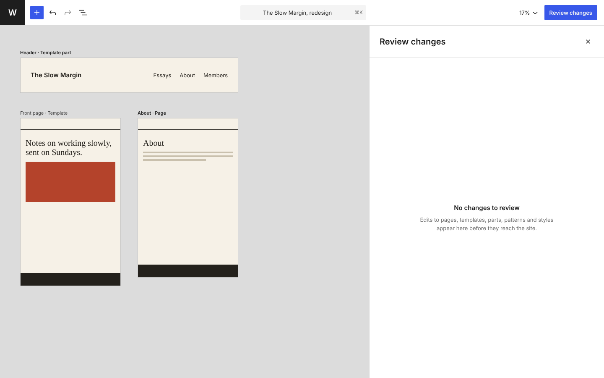

# Review changes: nothing to review

**State.** The drawer opened with no changes. Reachable only if the last change is undone or discarded while the drawer is open.

**Source.** [U]

## Regions used (defined in README.md)

- Header (H9 disabled)

## Elements specific to this screen

| Element | Components and text | Behaviour |
|---|---|---|
| Empty state | `EmptyState`: title "No changes to review", text "Edits to pages, templates, parts, patterns and styles appear here before they reach the site." No footer buttons. |  |

## Acceptance criteria

AC-STATE-03
