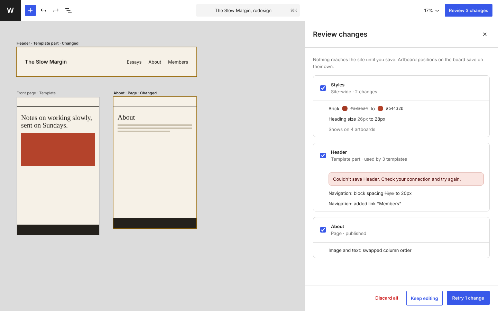

# Review changes: a save failed

**State.** One item failed to save.

**Source.** [U]

## Regions used (defined in README.md)

- Header

## Elements specific to this screen

| Element | Components and text | Behaviour |
|---|---|---|
| Failed item | Inside the item's card, above its changes: `Notice` error tone, "Couldn't save {name}. Check your connection and try again." Items that saved leave the list. The primary button reads "Retry {n} changes" / "Retry 1 change". |  |

## Acceptance criteria

AC-SAVE-04
