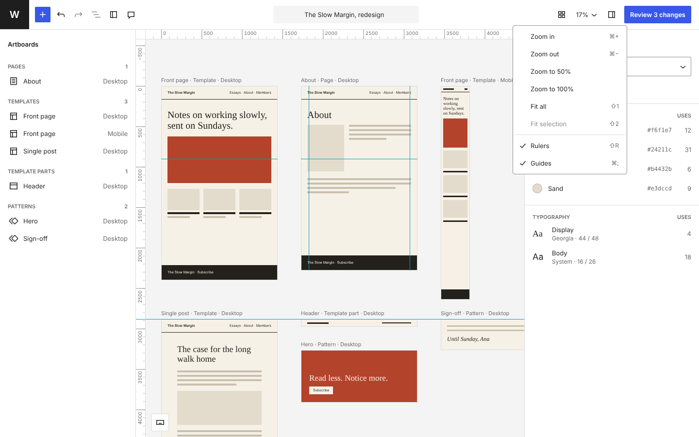

# Board: rulers shown, nothing selected

**State.** Rulers and guides are both shown. Nothing is selected, zoom 17%. The zoom menu (H8) is open. About has two vertical guides and one horizontal guide, Front page has one horizontal guide, and one board guide runs under the first row of artboards.

**Source.** [U] [D:Rulers] [R1]

## Regions used (defined in README.md)

- Header (H8 open, with its two checkbox items checked)
- Left panel, artboards by kind
- Canvas, with Rulers (R1 to R3, R5) and Guides (GD1)
- Right panel, Styles (Tokens tab)

## Elements specific to this screen

| Element | Components and text | Behaviour |
|---|---|---|
| Rulers at rest | R1 and R2 count board units from the board's origin; no span is shaded (R4 absent). R5 marks the board guide on the left ruler. | Follow pan and zoom (C34). |

In the image the board's origin is at Front page's top-left corner. The key hints beside the menu items ("⌘+", "⇧R" and the others) are not built: shortcuts are listed in the keyboard shortcuts dialog only. `[N]`

## Acceptance criteria

AC-RULER-01, AC-RULER-02, AC-GUIDE-12
