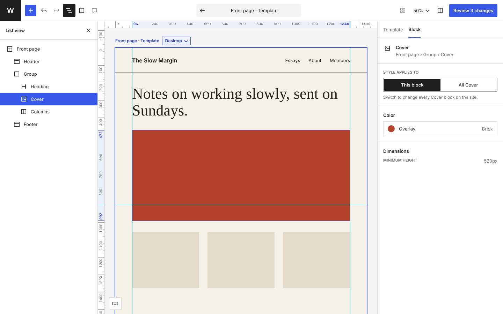

# Board: editing an artboard with rulers and guides

**State.** Front page (template, Desktop) is in edit at 50%. Its Cover block is selected. Front page has two vertical guides, at 96 and 1344, and one horizontal guide at 900.

**Source.** [U] [D:RulersEditing] [R1]

## Regions used (defined in README.md)

- Header (as on the "Main" screen)
- Left panel, list view
- Canvas (A2 on the Live artboard), with Rulers (R1 to R5) and Guides (GD1)
- Right panel, editing (Block tab)

## Elements specific to this screen

| Element | Components and text | Behaviour |
|---|---|---|
| Rulers in edit | Zero is Front page's top-left corner. R4 shades the selected block: "96" and "1344" on the top ruler, "472" and "992" on the left ruler, the block's edges in the page's pixels. R5 marks the artboard's three guides. | The span follows the block selection. With no block selected it is the artboard's extent. |
| Guides in edit | GD1 drawn over the Live artboard, above its blocks. | Take no pointer input (D114): a click on a line selects the block under it. |

The image was drawn without the block toolbar (H6); it is present as on the "Main" screen.

## Acceptance criteria

AC-RULER-04, AC-GUIDE-13
