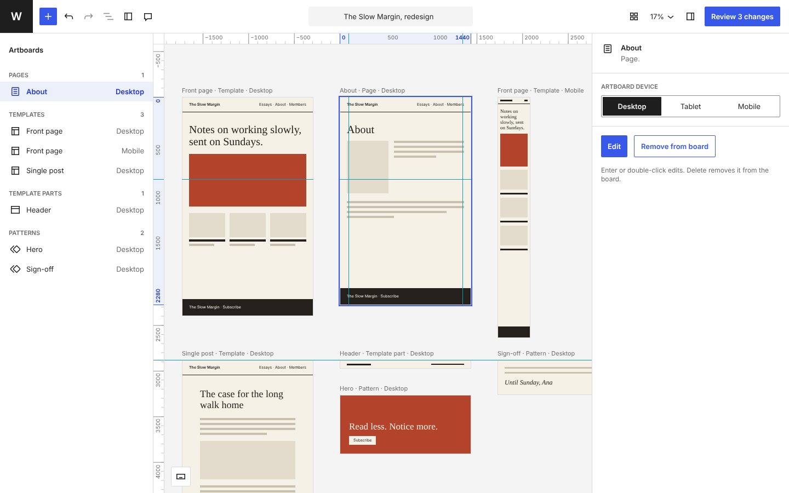

# Board: an artboard selected, rulers measure it

**State.** About is selected by a single click. Rulers and guides are shown.

**Source.** [U] [D:RulersSelected] [R1]

## Regions used (defined in README.md)

- Header
- Left panel, artboards by kind (About row highlighted)
- Canvas (A4 around About), with Rulers (R1 to R5) and Guides (GD1)
- Right panel: artboard settings, exactly as on the "Selected" screen. Nothing about guides is added to it (D112).

## Elements specific to this screen

| Element | Components and text | Behaviour |
|---|---|---|
| Rulers in context | Zero is About's top-left corner. R4 shades About's extent: "0" and "1440" on the top ruler, "0" and "2280" (its height) on the left ruler. Numbers left of and above zero are negative. R5 marks About's three guides and the board guide. | Change with the selection, at once. |

## Acceptance criteria

AC-RULER-03
