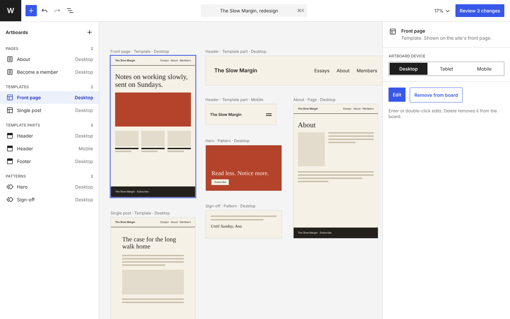

# Board: an artboard selected, not in edit

**State.** Front page is selected by a single click.

**Source.** [U] [N] for this panel's content

## Regions used (defined in README.md)

- Header
- Left panel, artboards by kind (Front page row highlighted)
- Canvas (A4 around Front page)

## Elements specific to this screen

| Element | Components and text | Behaviour |
|---|---|---|
| Right panel: artboard settings | Entity card as E5 (name; description "Template. Shown on the site's front page." For other kinds: "Page.", "Template part. Used by {n} templates.", "Pattern. Used in {n} templates."); E6 device control; `Button` solid "Edit"; `Button` outline "Remove from board"; `Text` weak "Enter or double-click edits. Delete removes it from the board." | Edit enters edit. Remove opens the remove dialog. |

## Acceptance criteria

AC-CANVAS-02, AC-SHELL-03
