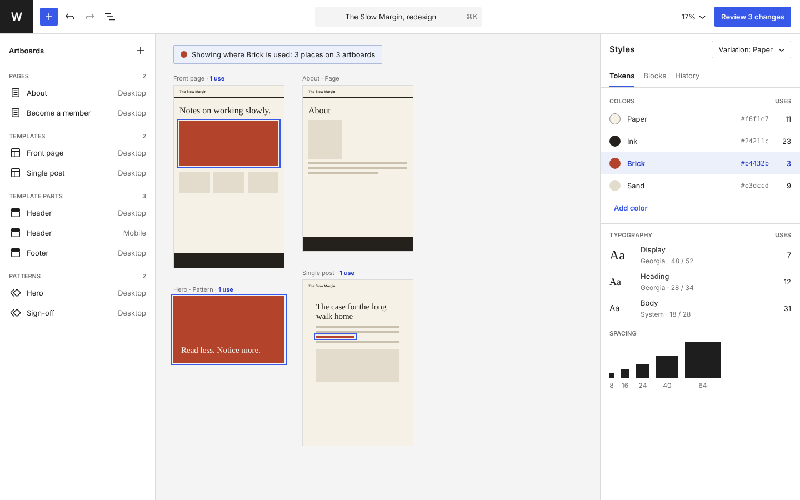

# Board: nothing selected, a token picked in Styles

**State.** The Brick colour token is selected in Tokens.

**Source.** [U] [D:Styles]

## Regions used (defined in README.md)

- Header
- Left panel, artboards by kind
- Canvas
- Right panel, Styles (Tokens tab, Brick row selected)

## Elements specific to this screen

| Element | Components and text | Behaviour |
|---|---|---|
| Usage banner | `Notice` info tone at the top left of the canvas, with a `wpc.ColorIndicator`. Text: "Showing where {token} is used: {n} places on {m} artboards" (singular "1 place", "1 artboard"). | Shown while a token is selected. |
| Artboard label count | Label becomes "{Name} · {Kind} · {n} uses" in brand colour for the count ("1 use"). |  |
| Usage outline | 2 px brand stroke with 2 px offset around each referencing block, on Preview and Live artboards. |  |

## Acceptance criteria

AC-INDEX-01, AC-INDEX-02, AC-INDEX-03
