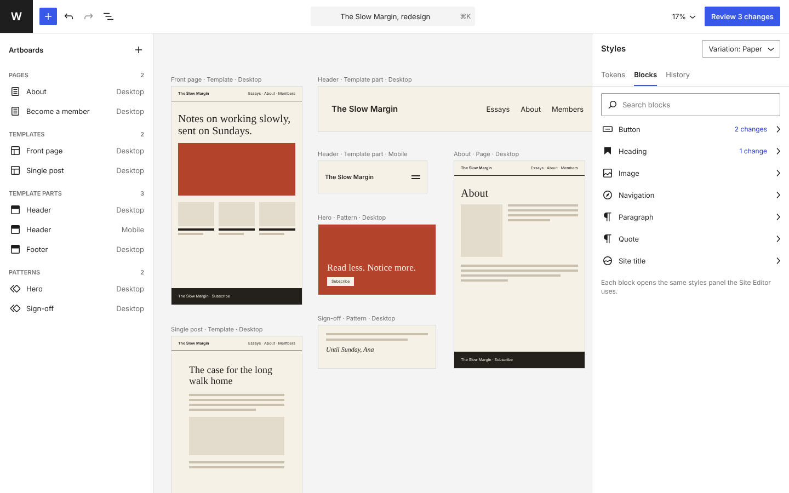

# Styles: Blocks tab

**State.** Nothing selected, Blocks tab.

**Source.** [U] [B7]

## Regions used (defined in README.md)

- Header
- Left panel, artboards by kind
- Canvas
- Right panel, Styles

## Elements specific to this screen

| Element | Components and text | Behaviour |
|---|---|---|
| Blocks tab | `wpc.SearchControl` placeholder "Search blocks"; a row per registered block type that supports styles: `be.BlockIcon`, title, a brand-coloured "{n} changes" / "1 change" when the user styles differ from the theme for that block, `chevronRight`. Help `Text`: "Each block opens the same styles panel the Site Editor uses." | Choosing a row shows `gs.GlobalStylesUI` at that block's path with a back control; back returns to the list. |

## Acceptance criteria

AC-STYLE-04
