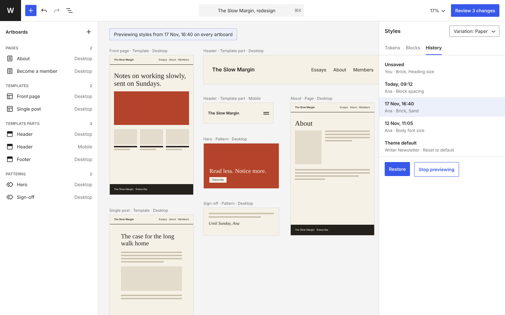

# Styles: History, previewing a revision

**State.** A past revision is being previewed.

**Source.** [U] [B7]

## Regions used (defined in README.md)

- Header
- Left panel, artboards by kind
- Canvas
- Right panel, Styles

## Elements specific to this screen

| Element | Components and text | Behaviour |
|---|---|---|
| History tab | Rows, newest first: "Unsaved" (only with unsaved style edits), then one per revision with date and time, author, and the names of what changed, then "Theme default". Selected row uses the brand surface. Buttons: `Button` solid "Restore", `Button` outline "Stop previewing". | Choosing a row previews it on every artboard. Restore makes it the edited styles. Stop previewing clears the preview. |
| Preview banner | `Notice` info tone on the canvas: "Previewing styles from {date}, {time} on every artboard". |  |

## Acceptance criteria

AC-STYLE-05
